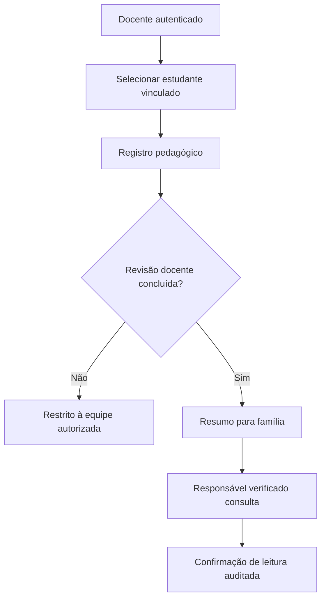

# Perfis e jornadas

## Perfis
| Perfil | Ações permitidas em produção planejada | Exclusões |
|---|---|---|
| AEE | Planos, evidências e laudos de estudantes vinculados, Canto da Calma | Outros estudantes |
| Regente | Objetivos pedagógicos e registros dos vinculados | Laudos clínicos |
| Mediador | Registros, rotina, planos autorizados, Canto da Calma | Edição/assinatura de planos e laudos |
| Coordenação | Gestão pedagógica da unidade e revisão de planos | Acesso clínico padrão |
| Secretaria/rede | Indicadores agregados, cobertura e prazos | Registros nominais sem fluxo excepcional |
| Família | Diário revisado e comunicações dos dependentes verificados | Informações internas de terceiros |
| Estudante | Atividades, CAA e rotina adaptada | Prontuários e dados de outros estudantes |
| Editora | Catálogo, licenciamento e conteúdo revisado | Laudos e dados nominais |

## Jornada: acompanhamento diário

## Jornada: plano individual
Rascunho → metas observáveis → revisão de outro profissional → aprovação/assinatura → execução → evidência baseada em rubrica → reavaliação e nova versão. **Nunca pontuação automática baseada em diagnóstico.**

## Jornada: usuário aluno
Escolher rotina ou atividade, pictogramas opcionais, pausa livre, sem cronômetro/ranqueamento, suporte por voz opcional, feedback acolhedor. Respostas só são guardadas após autorização e retenção definidas.

## Família e escola
Comunicados segmentados, canais pedagógicos e administrativos, calendário, formulários, autorizações e trilha de confirmação. Na DEMO: todos fictícios e em memória, sem envio real.

Ver também [[03-Arquitetura/Seguranca-e-RBAC]] e [[04-Modulos/Comunicacao-Escola-Familia]].
