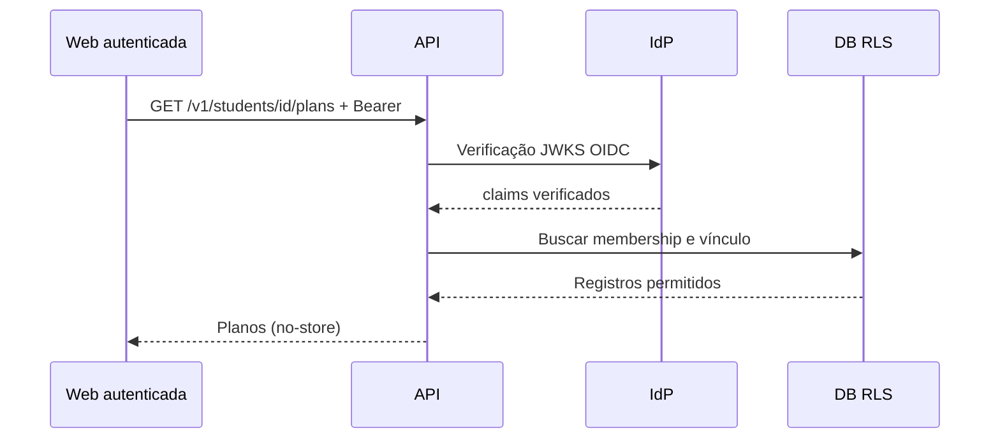

# API e contratos

## Estado
API em `server/`, **experimental, não publicada**; env `SINEA_SERVER_ENABLED=true` exigido para inicialização. Nenhum dado real nem gravação habilitada.

| Rota | Método | Segurança | Estado |
|---|---|---|---|
| `/healthz` | GET | Sem informação pessoal | Implementado (liveness) |
| `/v1/students/:uuid/plans` | GET | JWT OIDC, MFA, vínculo do DB, RLS | Contrato implementado, depende de infraestrutura |
| `/v1/students/:uuid/daily-records` | POST | JWT, MFA, idempotency-key | 503 intencional |
| `/v1/students/:uuid/calm-sessions` | POST | JWT, MFA, idempotency-key | 503 intencional |

## Segurança de sessão
Validar assinatura (JWKS HTTPS), issuer, audience, `exp`, `iat`, algoritmo, `sub` e `amr`. Não aceitar o papel informado pelo browser; buscar membership e vínculos sob RLS. Tenant indicado em header serve **apenas para selecionar contexto**, não autoriza acesso.

## Contratos de escrita futuros
- `Idempotency-Key` UUID por mutação.
- `If-Match` ou versão esperada para planos, concorrência otimista.
- Resposta `409 Conflict` com código genérico, sem vazar prontuário.
- Registro de quem, quando, origem, ação, versão e motivo, em serviço append-only.
- Validação de payload/schema, CSRF se usar cookie e limite de requisições no edge.
- Páginação, ordenação e erros padronizados com locale correto.
- Somente allowlist de MIME e tamanho para anexos (nunca conteúdo clínico público).

## Fluxo de leitura

O diagrama representa destino técnico; não implica serviço real conectado. Ver [[03-Arquitetura/Seguranca-e-RBAC]].
