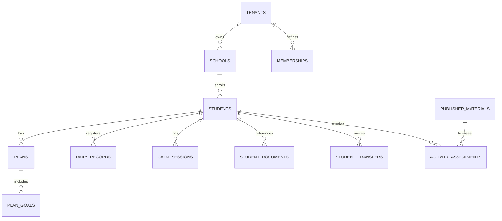

# Modelo de dados e integridade

## Entidades principais

## Migrações
| Arquivo | Responsabilidade | Estado |
|---|---|---|
| `database/migrations/001_sinea_core.sql` | tenant, escolas, profissionais, estudantes, planos, documentos, atendimentos, Canto, transferências, licenças e auditoria | Testado em CI |
| `002_scoped_read_rls.sql` | políticas SELECT por vínculo com role `sinea_api` não-login | Testado em CI |
| `003_extended_domain.sql` | turmas, matrículas, estudo de caso, editora, BNCC, outbox, IA, retenção e solicitações de titulares | Estrutura fechada, testada |

## Constraints
Chave UUID, `tenant_id` nas entidades escolares, referência composta `tenant_id/id`, `client_mutation_id` único, `version` em planos e registros, eventos de auditoria append-only; não permitir sobrescrita silenciosa.

## Direitos e laudos
Anexos no banco são apenas metadados. Arquivo binário **não** deve entrar no DB/Git nem ser público. Prever object storage privado cifrado e URLs assinadas de curta duração, trilhas de consulta, download e impressão.

## Índices e escala
Índices por `tenant_id, school_id`, `student_id`, tempo dos registros; planejar particionamento de eventos para redes grandes e índices de retenção. Avaliar até 50 mil estudantes com testes de carga sem dados reais.

## Operação ainda bloqueada
O backend de escrita e a RLS de escrita não foram implementados e não devem ser liberados por simples mudança no frontend. Ver [[05-Seguranca/Privacidade-e-LGPD]].
