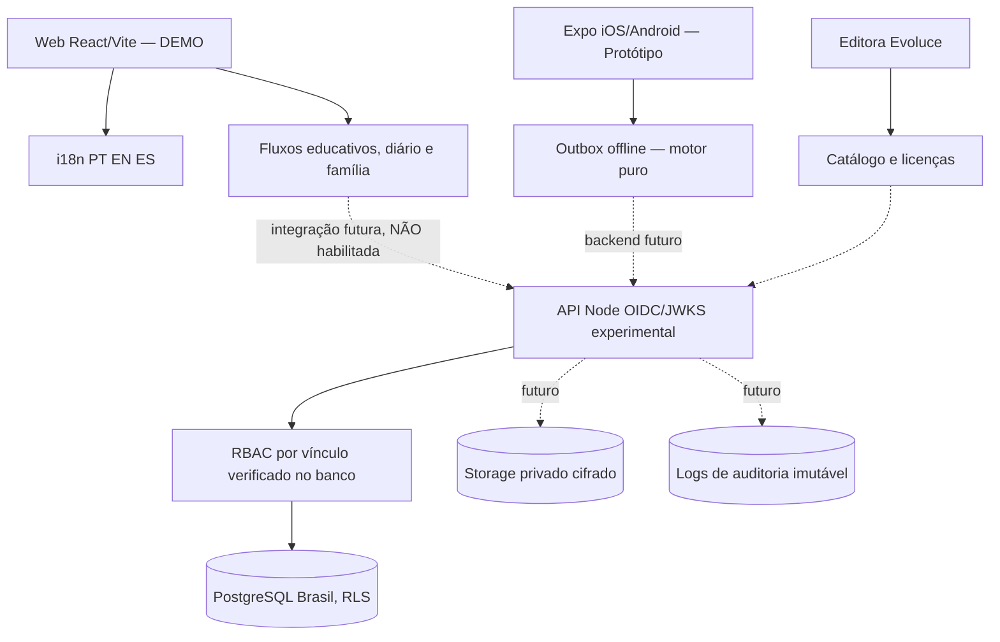

# Arquitetura lógica SINEA

## Implementação observada
- `src/main.jsx` inicializa `src/sinea/SineaAppV2.jsx`.
- `src/sinea/i18n.js` concentra traduções.
- `src/domain/*.js`: regras puras de PEI, Canto, transferências, licenciamento, IA e métricas.
- `database/migrations/001..003`: PostgreSQL com RLS forçada; migração 002 concede leituras limitadas à role sem LOGIN `sinea_api`.
- `server/`: API experimental com JWT OIDC/JWKS e MFA; escrita desabilitada.
- `mobile/`: Expo DEMO e motor offline sem criptografia nativa.

## Princípios
Negar por padrão, menor privilégio, isolamento por rede e escola, separação de dado clínico e pedagógico, confirmação por segundo profissional em aprovações, idempotência de mutações offline, minimização e logs sem dados pessoais.

## Pendências de integração
O web demo não faz chamadas reais à API. O backend não tem autenticação implantada nem persistência de escrita. Nenhuma decisão de arquitetura altera esse estado sem passar gates de segurança.

Links: [[03-Arquitetura/Modelo-de-Dados]], [[03-Arquitetura/API-e-Contratos]], [[05-Seguranca/Threat-Model]].
