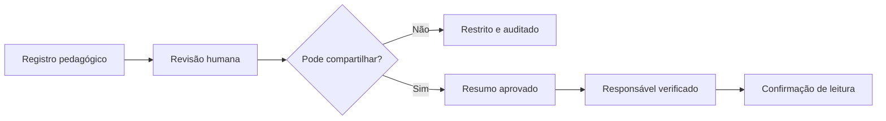

# Diário de Acompanhamento Inclusivo

## Inspiração funcional
A agenda escolar digital inspira facilidade de registrar e comunicar rotina. O SINEA adiciona vínculo com objetivos pedagógicos, PEI e dois níveis de visualização. Referência funcional: Agenda Edu, ClipEscola e ClassApp; sem copiar material proprietário.

## Campos pretendidos
Instituição, estudante, responsável profissional, data/hora e modalidade; atividade realizada; escala 1–5 como observação humana; apoios usados; meta PEI/PDI/PAEE; adequações e observações. Eventuais fotos de evidência devem evitar rosto por padrão, permanecer no storage privado e passar por revisão e controle jurídico.

## Duas visualizações
**Profissional:** nota técnica detalhada, somente perfis vinculados.  
**Família:** resumo redigido/revisado por educador, linguagem não estigmatizante, excluindo laudos, diagnósticos, observações confidenciais e dados de outros alunos.

## Workflow de publicação

## Estado
`DiaryPage` da nova UI é demo somente leitura, com botões de visualização; sem persistência. `server/src/http.mjs` possui rota POST bloqueada. A UI exibe advertência sempre.

## Critérios de aceite
- [ ] Persistência com vínculos, dupla visibilidade e auditoria.
- [ ] Responsável legal validado, publicação revogável e expiração.
- [ ] Filtros por período, turma, canal e estudante, sem vazamento.
- [ ] Não salvar transcrição de áudio sem finalidade e base legal definida.
- [ ] PDF acessível e tradução dos três idiomas.
