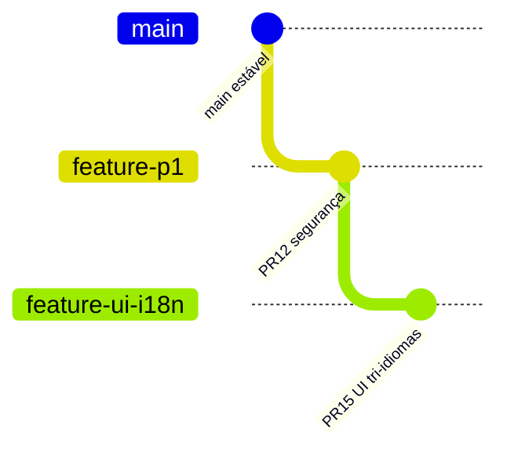

# Ambientes, Git, CI e deploy

## GitHub e Vercel
GitHub `HelpUSA/autista`; `main` é a publicação demonstrativa informada. Vercel projeto `help-us/autista`, domínio provisório `autista.helpusbr.com` e URL secundária `autista-umber.vercel.app`. DNS sob Cloudflare precisa verificação operacional de CNAME, SSL e HTTPS.

## Fluxo de branches

O diagrama é ilustrativo; não usar para presumir aprovação de merges.

## Pipeline
`.github/workflows/ci.yml` testa Node/Vite, domínio, backend Node, auditoria de dependências e migrações SQL 001–003 com RLS e isolamento de rede sintética. Falha de um gate bloqueia merge.

## Gate Vercel
1. Revisar CI e code review.
2. Validar em preview com conteúdo sintético.
3. Testar mobile real e três idiomas.
4. Confirmar proteção de dados, SLO e backup de acordo com etapa.
5. Aprovação formal do usuário/cliente para mudança em produção.
6. Monitorar deploy e rollback para último SHA conhecido.

## Segurança da infraestrutura
Não colocar tokens no chat nem no Git; Vercel/Cloudflare Secrets apenas em locais autorizados; DNS change é separado de feature release. Configurar headers CSP, HSTS, CORS restrito e monitoramento antes do piloto.

## Observabilidade
Métricas de latência, erros e disponibilidade sem dados pessoais; nenhum conteúdo de prontuário em logs. Testar volume por escolas e 50 mil estudantes antes de reivindicar escala.

Links: [[06-Operacao/Testes-e-Homologacao]], [[07-Governanca/Roadmap-e-Pendencias]].

## Situação de alias comunicada pelo Antigravity

O executor reportou em 01/11/2026 a correção dos aliases `autista.helpusbr.com` e `autista-umber.vercel.app` para o deployment `dpl_C7wjFSyoqNteZuhVTjE3DWVHQAJC`. O GitHub continua com PRs de trabalho abertas e `main` independente do alias. Sempre cruzar SHA de deployment com SHA do repositório conforme [[06-Operacao/Estado-Git-e-Deploy]].
