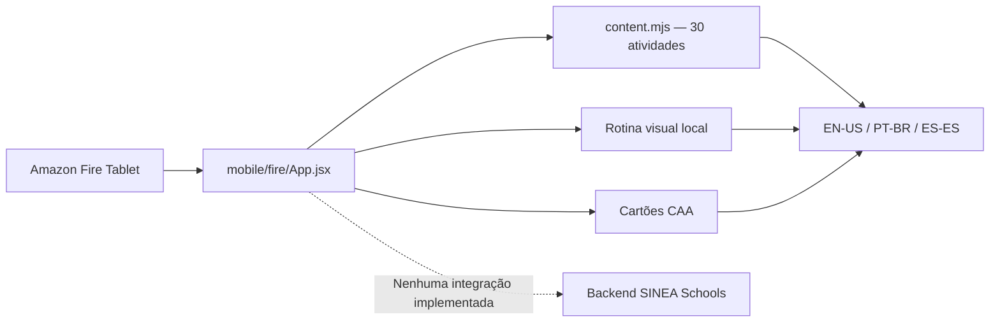

# SINEA Activities — edição offline independente

> [!danger] Versão para testes internos
> Código criado em `mobile/fire/`. **Sem autorização de submissão nem publicação**; ainda não foi gerado APK assinado, auditado manifesto nativo ou validado funcionamento em dispositivo físico.

## Decisão técnica

O aplicativo inicial para Fire Tablet é um **projeto Expo totalmente separado** da aplicação mobile escolar. Isso minimiza a inclusão inadvertida de bibliotecas, telas, módulos de login, mensagens, prontuários, telemetria e banco do SINEA Schools no artefato comercial infantil.

### Diagrama

## Conteúdos incluídos para teste

| Tema | Cartões | Objetivo educacional não clínico |
|---|---:|---|
| Cores | 6 | Identificar cores com símbolo e nome |
| Formas | 6 | Identificar formas com representação e texto |
| Contagem | 6 | Contar grupos de 1 a 6 estrelas |
| Comunicação | 6 | Explorar cartões de necessidades e escolhas |
| Sequência | 6 | Antecipar a etapa seguinte de uma rotina ilustrativa |
| **Total** | **30** | Sem notas, rankings ou limite de tempo |

Além das atividades, o app possui seis etapas de rotina visual e seis cartões de comunicação, ambos localizados nos três idiomas. O progresso é somente estado React em memória; ao fechar o aplicativo não há histórico guardado.

## Segurança por configuração (não por promessa)

- `mobile/fire/app.json` declara bloqueio de permissões `INTERNET`, `ACCESS_NETWORK_STATE`, câmera, microfone, localização, contatos e notificações.
- `expo.updates.enabled=false` evita depender de atualizações OTA no app inicial; verificar configuração final e compatibilidade com instalador Amazon.
- O código de `App.jsx` e `content.mjs` não importa módulos de API, storage, SDK de analytics nem funcionalidades escolares.
- `extra.storeSubmissionAuthorized=false` e package ID `com.helpus.sinea.activities.preview` sinalizam que **não é o identificador definitivo**.
- Nenhuma confirmação de que o APK final está livre de tráfego pode ser dada antes de inspeção de manifesto e ensaios em hardware.

## Testes automatizados

`npm run test:fire` na raiz:
1. Paridade de conteúdo e tradução EN/PT/ES.
2. Exatamente 30 perguntas, respostas únicas e contagem por tema.
3. Rotina e cartões em três idiomas.
4. App interno fechado para envio ao marketplace.
5. Permissões Android de rede e dados sensíveis bloqueadas na configuração fonte.
6. Ausência de importação, API e armazenamento local no escopo da edição.

Para testar build nativo, o executor local precisa rodar `cd mobile/fire && npm install && npm test && npx expo-doctor`, gerar lockfile, fazer build Android interno EAS, examinar Manifest mesclado, verificar permissões, instalar em Fire Tablet físico e capturar evidências.

## Lacunas antes do mercado

- [ ] Revisão e expansão pedagógica e símbolos adequados à faixa etária por especialistas.
- [ ] Revisão linguística por falantes nativos EN/ES e PT-BR.
- [ ] Acessibilidade real em Fire OS (TalkBack/VoiceView, contraste, zoom, tamanhos, orientação).
- [ ] Performance em Fire HD de diferentes gerações e uso sem rede.
- [ ] Identidade do app, ícones e screenshots reais aprovados.
- [ ] Aprovação de direitos de uso da marca HelpUS e de todos os ativos.
- [ ] COPPA / diretrizes Amazon para público infantil, avisos, dados, preço e suporte com responsável jurídico.
- [ ] Conta Amazon Developer da HelpUS LLC e documentação fiscal.
- [ ] Entrega assinada, release notes, versionCode e testes de atualização.
- [ ] Autorização explícita do Master antes da submissão.

Relacionamentos: [[08-Estados-Unidos/Plano-Amazon-Appstore]], [[08-Estados-Unidos/Gates-de-Lancamento-US]], [[06-Operacao/Handoff-Antigravity]].

## Auditoria estática do APK (nova etapa P0)

Foi incluído `mobile/fire/apkManifestGate.mjs` com teste por evidências de `aapt dump badging`, `aapt dump permissions` e `aapt dump xmltree`. As permissões de rede, mídia e identificação são proibidas na edição offline, a identificação da aplicação deve conferir e os modos `debuggable`/`testOnly` são bloqueados. O comando `npm run inspect:apk` retorna SHA-256 do APK fornecido. É apenas análise estática de evidências fornecidas pelo executor; não inspeciona por si só tráfego, assinatura, conteúdo de SDK, privacidade ou regras da Amazon.
